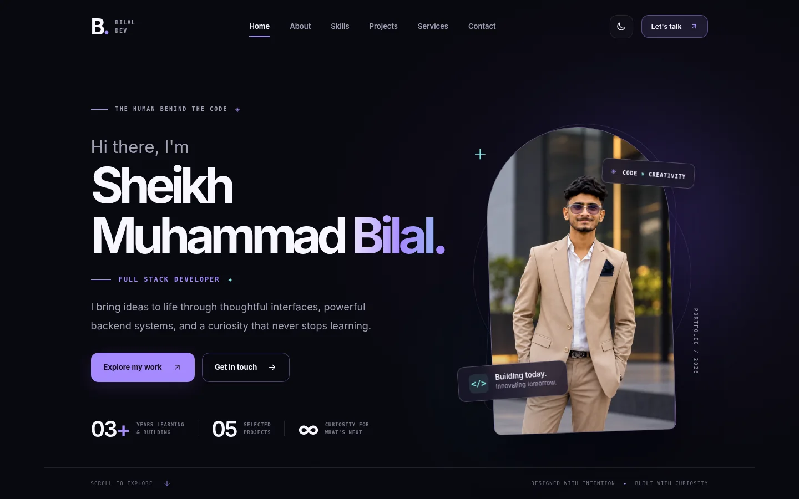

# Sheikh Muhammad Bilal — Neo-Luxe Portfolio



A personal portfolio for **Sheikh Muhammad Bilal**, Full Stack Developer. Built as a polished, responsive, accessible frontend project for **MTech Solutions — Frontend Development Internship, Batch 01 / Task 01**.

## Stack

- HTML5 (semantic markup)
- CSS3 (custom design system, responsive layouts, themes, animations)
- Vanilla JavaScript (functional interactions; no runtime dependencies)

**Why no React dependency?** The internship brief explicitly permits HTML/CSS/JavaScript. This version runs straight from the source, with no installation or build step, making it practical to review and publish by the deadline. The site is structured for later migration into React if desired.

## Run locally

Option A: Open `index.html` in your browser.

Option B (recommended — local web server):

```bash
# Python 3
python -m http.server 8000
```

Visit `http://localhost:8000`.

## What changed in V3 (October 2026)

- Reorganized skills into a **core stack**, **project-based experience**, and **design/integration** group, with broader learning tools inside an expandable section. No unverified proficiency percentages.
- Reduced services to four realistic capabilities instead of presenting every explored technology as a specialist offering.
- Expanded each of the five projects with a challenge, implementation details, technical workflow, evidence, limitations, and honest source visibility.
- Clarified that portfolio artwork is illustrative, **not screenshots**. No fabricated user metrics or live-deployment claims.
- Improved background behavior while case-study dialogs are open and stopped the custom cursor animation from running continuously when stationary.
- Retained the updated one-page PDF resume with Hamdard BSCS (Fall 2026) and completed Aptech diploma.
- Corrected share-preview metadata: `og:image` and `og:url` must be filled with **absolute public URLs after deployment** instead of an unreliable local relative path.

## Site sections

1. Hero / Home — identity, portrait, buttons and a downloadable one-page PDF resume
2. About — professional bio and education
3. Skills — focused skills with an expandable additional-tools section
4. Projects — 5 projects, 3 featured, working category filters and detail dialogs
5. Services — four grounded development/design services
6. Contact — accessible, validated email-draft form
7. Footer — copyright, links, back to top

## Features

- Smooth internal navigation and scroll progress
- Entrance animations and scroll reveal
- User-selected dark/light themes (localStorage) and system preference
- Custom desktop cursor, magnetic CTAs, subtle 3D card tilt
- Project category filters and keyboard-operable case-study dialogs
- Accessible mobile navigation, sensible labels and focus styling
- Respect for `prefers-reduced-motion`
- Responsive mobile/tablet/desktop layouts
- SEO metadata, optimized `.webp` portrait, lazy-free hero load and no large JavaScript framework bundle

## Contact form (important)

The contact form validates input on the frontend. On submit, it **prepares a draft** addressed to `bilal2023sheikh@gmail.com` and offers an **Open email app** link using `mailto:`; it does **not silently deliver an email**, and never shows a misleading 'message sent' banner. It also offers a **Copy message instead** fallback. To receive contact submissions directly inside the site, add a legitimate email provider or backend.

## Case-study evidence and screenshots

Each project modal includes a clear problem statement, verified or creator-provided implementation notes, a three-stage workflow, evidence, and limitations. See `PROJECT_EVIDENCE.md` for source provenance. **Real screenshots are pending**; covers remain clearly labeled illustrations. Do not state that the site or private projects are deployed when they are not.

LeadFlow AI: `docs/LeadFlowAI_README_DRAFT.md` is a sanitized draft for a future public repository documentation update. **It has not been published to GitHub.** Review it before copying to GitHub; do not upload any `.env` file or supplied source ZIP.

## Source privacy and project credits

- EventSphere and EarthScape are marked as private work; no private repository URLs are shown.
- The LeadFlow AI GitHub repository currently exposes overview documentation; the full uploaded implementation is **not included here**.
- EarthScape's supplied ZIP contains a project walkthrough video, not source code. Its portfolio text deliberately avoids unverified code-level claims.
- Project artwork shown in the gallery is original *illustrative cover art*, not screenshots of the actual running apps.
- The source ZIPs supplied for portfolio review are **not embedded** here. This prevents accidental inclusion of `.env` files, access tokens, build artifacts and other private data.
- We did not add the unrelated Car Showroom project as a personal project because the uploaded repository's README credits other authors.

## Content updates

- Edit `js/data.js` to change technologies, services, project descriptions, or GitHub links.
- Edit `index.html` to change name, biography, social accounts, and contact information.
- The Download resume link points to `assets/Sheikh_Muhammad_Bilal_Resume.pdf`. Replace that PDF whenever the resume is updated.
- Replace `assets/bilal-portrait.webp` with a new portrait (keep the same filename).
- Theme color tokens are located at the top of `css/styles.css`.

## SEO setup when the public URL exists

After deployment, add two tags within `index.html` `<head>`:

```html
<meta property="og:url" content="https://YOUR-PUBLIC-DOMAIN/">
<meta property="og:image" content="https://YOUR-PUBLIC-DOMAIN/assets/portfolio-preview.webp">
```

Also add a canonical URL if your permanent site domain is known. Use the real deployed domain, **never** a placeholder in the submitted version. Test the publicly accessible image URL directly.

## Deploy on Netlify

1. Upload **this entire folder** through Netlify's drag-and-drop deploy interface.
2. The publish directory is the folder containing `index.html`.
3. No build command is required.
4. Open the live URL and test the projects, mailto form, GitHub links and mobile navigation.

## Deploy on Vercel

1. Import the GitHub repository into Vercel.
2. Framework preset: **Other** (static HTML website).
3. Build command: leave blank; output directory: `.` (site root).
4. Deploy and verify the live URL.

## GitHub submission

Create a **new public GitHub repository for this portfolio only**. Do not upload user-provided project source ZIPs or sensitive config files. Push `index.html`, `css/`, `js/`, `assets/`, `README.md` and `LICENSE` (optional).

Google Classroom submission requires:
- Your full name
- Public portfolio GitHub repository link
- Live Vercel or Netlify URL
- Short 2–4 line project note

### Example submission note

> I built a professional, responsive personal portfolio using HTML, CSS and JavaScript. The website includes categorized skills, interactive project case studies, a theme switcher, accessible navigation and a validated contact form that opens an email draft. It is optimized for mobile, tablet and desktop, and deployed as a live static website.

## Testing checklist

- [ ] Desktop hero and portrait fit cleanly
- [ ] Mobile/tablet/desktop sections have no horizontal overflow
- [ ] All internal anchors scroll to correct sections
- [ ] Project filter tabs and detail dialogs work
- [ ] Theme choice persists on refresh
- [ ] Expanded case studies show challenge, engineering, evidence and limitations
- [ ] Contact validation works and email draft opens in configured email app
- [ ] Keyboard focus, escape-to-close and reduced motion work
- [ ] Public GitHub and LinkedIn links open correctly
- [ ] Live URL and portfolio repository URL are submitted successfully
- [ ] Run the static validation script: `python checks/validate.py` (requires Python 3)
- [ ] Browser testing must still be performed locally before submission; the automated browser was restricted in the build environment

---

Made with care and curiosity. © Sheikh Muhammad Bilal, 2026.

## Testing status

Syntax and local file integrity are validated using `checks/validate.py` and Node.js `--check`. Browser interaction screenshots/automation were not fully completed in the build environment due to access restrictions. Please manually verify mobile menu, project filters/dialogs, themes, contact form, navigation and downloads on your device, especially after publishing.

## Resume details (October 2026)

The downloadable PDF now includes Hamdard University BS Computer Science (Fall 2026 - ongoing), and updates the Aptech Diploma in Software Engineering to completed October 2026. The resume keeps the work-experience and existing academic-project entries from the user-provided CV.
